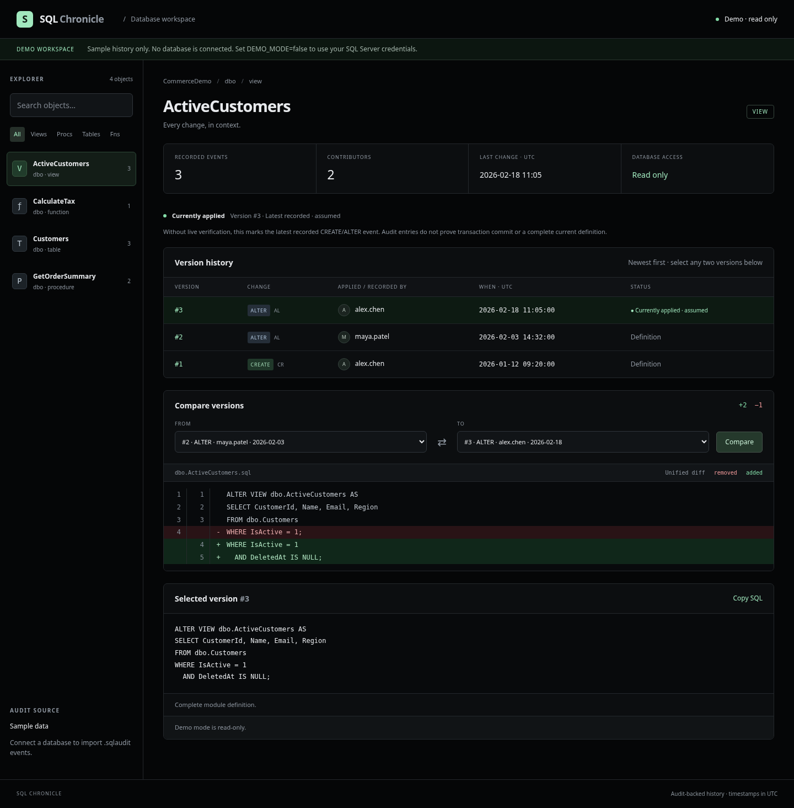

# SQL Chronicle

A Python/Flask workspace for SQL Server object history, audit provenance, version comparison, and permission-checked module deployment. The UI uses a black background, a compact searchable explorer, and red/green SQL diffs. Run it locally in your browser with Docker Compose or Python.



## Features

- History for views, stored procedures, functions, tables, and other named audited objects.
- Each recorded event shows its original SQL login, UTC timestamp, action name, action ID, and SQL text.
- Compare **any two recorded versions of the same object**, including reversed comparisons. Copy the selected SQL.
- Read server-side `.sqlaudit` files with `sys.fn_get_audit_file`; resolve action IDs from `sys.dm_audit_actions` on the actual server.
- Reassemble sequenced audit fragments and deduplicate repeated imports in SQLite.
- Sign in with **your own SQL Server username/password** in connected mode. Deploy complete view/procedure/function definitions using that login's effective permissions. No shared elevated deployment account.
- Require explicit object-name confirmation, recheck permissions and the live-definition fingerprint, execute `CREATE OR ALTER` in a transaction, and verify the stored definition before committing.
- Highlight the recorded version matching the live definition for a login that can deploy. Record application deployments separately, including the actual executing SQL login and time.
- For read-only/demo users or unavailable live verification, highlight the latest recorded CREATE/ALTER event as **currently applied · assumed**. This is a fallback, not a claim of verified database state. DML events do not become object definitions.
- Read-only demo with sample views, procedures, functions, and table activity, so you can try the UI without a database.
- Non-root Docker image, persistent history volume, healthcheck, AWS ECR/GitLab registry publishing scripts, and manual GitLab CI publishing jobs.

## Important audit semantics

`.sqlaudit` is SQL Server's binary audit format. It is **not a SQL script** and cannot be reliably decoded by Python alone. SQL Server reads it; the application receives rows over ODBC. The audit path is on the **SQL Server machine**, not your laptop or the Flask container. For files copied from another machine, place them on a SQL Server host accessible to its service account and point `AUDIT_FILE_PATTERN` at that location.

Audits record **statements**, not a guaranteed full schema snapshot:

- CREATE/ALTER module statements can contain full view/procedure/function definitions.
- `ALTER TABLE … ADD …` is a partial migration, not a full replacement table schema. CREATE TABLE is retained as historical SQL, but table replay is deliberately disabled to avoid data loss.
- INSERT, UPDATE, and DELETE change rows, not object definitions. They appear as activity records and are never replayed.
- DROP events are preserved for review and are never replayed.
- An audit's `succeeded` flag describes the **permission check**, not transaction commit. Rolled-back changes can still appear in history.
- Missing files, disabled auditing, truncated fragments, encrypted modules, unavailable definitions, SET options, or dependency changes can prevent exact reconstruction. The app does not invent a complete definition from partial evidence.

See [ISSUES.md](ISSUES.md) for current limits and live validation requirements.

## Run locally with Docker (recommended)

Prerequisites: Docker Engine/Desktop and Docker Compose v2. The image installs Microsoft's ODBC Driver 18 (accepting its driver EULA during the build).

```bash
git clone https://github.com/trentenAB/mssql-management.git
cd mssql-management
docker compose up --build -d
```

If you already have the project files, run the Docker command from that project directory instead of cloning. Open **http://localhost:8000** in your local browser. Default mode is demo; no SQL Server is needed.

```bash
docker compose logs -f web
docker compose down
```

History survives `down` in the named `history` volume. `docker compose down -v` **deletes all local history**. The app binds only to the host's loopback interface by default.

### Python alternative

Requires Python 3.12+; for connected mode also install unixODBC and [Microsoft ODBC Driver 18](https://learn.microsoft.com/sql/connect/odbc/linux-mac/installing-the-microsoft-odbc-driver-for-sql-server).

```bash
./scripts/run-local.sh
```

Or manually:

```bash
python3 -m venv .venv
.venv/bin/python -m pip install -r requirements-dev.txt
.venv/bin/flask --app wsgi run --host 127.0.0.1 --port 8000
```

On Windows, activate `.venv\Scripts\activate`, install requirements with `python -m pip`, then use `python -m flask --app wsgi run --port 8000`. The development server is for local use. The Docker image uses Gunicorn.

## Connect your SQL Server

Target: SQL Server **2016 SP1+**, with SQL authentication enabled and audit files already configured. SQL Server 2022 is recommended. No SQL Server or credentials are bundled.

1. Copy `.env.example` to `.env` (ignored by Git). Generate a signing secret with `python3 -c "import secrets; print(secrets.token_hex(32))"` and enter it locally in `.env`.
2. Set:

   ```dotenv
   DEMO_MODE=false
   FLASK_SECRET_KEY=your-locally-generated-random-secret
   SQLSERVER_HOST=sqlserver.example.com,1433
   SQLSERVER_DATABASE=YourDatabase
   AUDIT_FILE_PATTERN=/var/opt/mssql/audit/*.sqlaudit
   HISTORY_FILENAME=history.sqlite3
   COOKIE_SECURE=false
   ```

   For Windows SQL Server, a path such as `D:\Audit\*.sqlaudit` is supported. These are server-side paths. Keep demo and real history in separate SQLite files. Compose reads `.env`; direct Python execution requires you to export these variables yourself. Direct Python also supports `HISTORY_DATABASE` as an absolute file path.
3. Run `docker compose up --build -d`. Sign in using your **SQL login**, then select **Import audit events**. Imports are manual; repeated imports are idempotent for the same audit events.
4. Select an object and two versions. If your login can deploy, select a complete definition, expand **Apply this version**, review its SQL, type `schema.object`, and submit.

ODBC uses `Encrypt=yes;TrustServerCertificate=no`. Use a server certificate valid for the configured hostname and trusted by the client. For a private CA, install your organization's CA in the container's trust store in a derived image and run `update-ca-certificates` as root during that image build. Do not disable verification. A SQL Server self-signed default certificate is not sufficient without correctly configuring trust and hostname validation.

For remotely hosted web access, use an HTTPS reverse proxy, set `COOKIE_SECURE=true`, and restrict access to authorized people. The app is designed for a local/small trusted team deployment, not public Internet exposure.

### SQL permissions and audit setup

Review [sql/audit-setup.sql](sql/audit-setup.sql) with your DBA. It is a template that must be edited for the actual database and server path; the app does **not** execute it automatically. Enable the relevant audit specification before changes occur—there is no retroactive audit history.

Audit read and deployment are separate permissions:

- SQL Server 2019 and earlier: `CONTROL SERVER` to read audit files.
- SQL Server 2022+: `VIEW SERVER SECURITY AUDIT` to read audit files.
- Existing modules: effective `ALTER` permission on the object (including appropriate inherited roles such as `db_ddladmin`), or sysadmin.
- Absent modules: `ALTER` on the schema plus the database-level `CREATE VIEW`, `CREATE PROCEDURE`, or `CREATE FUNCTION` permission, or sysadmin.
- The live definition must be visible for safe verification. Encrypted definitions cannot be applied through this UI.

A DBA can import audit history; other SQL-authenticated users of this deployment can browse the shared cache without audit-read privilege. **The history cache is not filtered by each viewer's SQL object visibility**. Only deploy with this app when all admitted users are authorized to see its configured database's audit text. Use a separate deployment/history file per security boundary.

The app never elevates privileges. SQL Server is the final authority and can reject a deployment despite the preliminary permission check (dependencies, policies, object type conflicts, etc.). No passwords are saved in SQLite, browser cookies, files, or logs. Login credentials are held only in server memory, expire after eight hours, and are removed at logout. Restarting the process signs everyone out. Run **one Gunicorn worker**, as in the Dockerfile; multiple workers would require a shared secure credential/session design.

### Audit actions

These are the usual short IDs; the runtime DMV mapping is authoritative:

| User operation | Typical action_id | Meaning in this app |
| --- | --- | --- |
| CREATE | `CR` | Full module definition when eligible; other DDL is review-only |
| ALTER | `AL` | Full module definition when eligible; partial DDL is review-only |
| DROP | `DR` | Review-only object activity |
| INSERT | `IN` | Review-only row activity |
| UPDATE | `UP` | Review-only row activity |
| DELETE | `DL` | Review-only row activity |

```sql
SELECT DISTINCT action_id, name, class_desc
FROM sys.dm_audit_actions
WHERE name IN ('CREATE','ALTER','DROP','INSERT','UPDATE','DELETE');
```

CREATE/ALTER/DROP object events are captured with `SCHEMA_OBJECT_CHANGE_GROUP` and `DATABASE_OBJECT_CHANGE_GROUP` as appropriate. INSERT/UPDATE/DELETE must be enabled as database/object-scoped audit actions. DML auditing can be expensive and can capture sensitive literals; choose its scope and retention deliberately.

Microsoft references consulted:

- [sys.dm_audit_actions](https://learn.microsoft.com/sql/relational-databases/system-dynamic-management-objects/sys-dm-audit-actions-transact-sql)
- [sys.fn_get_audit_file, columns and permissions](https://learn.microsoft.com/sql/relational-databases/system-functions/sys-fn-get-audit-file-transact-sql)
- [SQL Server audit action groups and actions](https://learn.microsoft.com/sql/relational-databases/security/auditing/sql-server-audit-action-groups-and-actions)

## Publish a container

These scripts **build and push** when you explicitly run them. They do not deploy infrastructure. No registry push has been performed as part of development.

### AWS ECR

Create the ECR repository first. Install AWS CLI and Docker. Authenticate AWS using your normal local profile, role, or federation; do not put credentials in source files. The caller needs ECR authorization-token and image-upload permissions for the destination.

```bash
export AWS_ACCOUNT_ID=123456789012
export AWS_REGION=us-east-1
export ECR_REPOSITORY=mssql-management
export IMAGE_TAG=v1
./scripts/push-ecr.sh
```

### GitLab container registry

Use a GitLab deploy/personal access token with `write_registry`, or GitLab CI's supplied registry credentials. Provide it securely through your shell/CI secret manager; do not commit it or paste it into documentation.

```bash
export CI_REGISTRY=registry.gitlab.com
export CI_REGISTRY_IMAGE=registry.gitlab.com/your-group/mssql-management
export CI_REGISTRY_USER=your-registry-user
# Set CI_REGISTRY_PASSWORD securely in your environment.
export IMAGE_TAG=v1
./scripts/push-gitlab.sh
```

Both scripts use `docker login --password-stdin`, isolate temporary Docker authentication, and clean it on exit. Without `IMAGE_TAG`, the Git commit is used as the tag. Ensure your working tree represents the revision you intend to publish.

[.gitlab-ci.yml](.gitlab-ci.yml) runs tests and exposes **manual** GitLab/ECR publishing jobs on the default branch. Docker-in-Docker jobs require a privileged runner with a shared `/certs/client` volume and TLS enabled. Configure `AWS_ACCOUNT_ID`, `AWS_REGION`, `ECR_REPOSITORY`, and masked/protected AWS credential variables for the ECR job, or supply federation through your organization's runner configuration. Built-in `CI_REGISTRY_*` variables support the GitLab job.

## Architecture and files

```text
app/
  __init__.py          Flask routes, SQL login sessions, CSRF, deployment workflow
  sqlserver.py         pyodbc audit ingestion, permission checks, transactional DDL
  definitions.py       conservative definition eligibility and normalization
  store.py             SQLite history, audit deduplication, demo fixtures
  templates/           Jinja browser views; SQL is HTML-escaped
  static/              black UI stylesheet and small vanilla-JS enhancements
sql/audit-setup.sql     DBA-reviewed SQL audit template
scripts/               local start, AWS ECR and GitLab registry publishing
Dockerfile             Python + Microsoft ODBC 18, non-root Gunicorn runtime
compose.yaml           localhost web service and persistent SQLite volume
.gitlab-ci.yml         test pipeline and manual image publishing
requirements*.txt      pinned direct Python dependencies
pytest.ini, tests/     isolated automated tests; no live SQL Server required
ISSUES.md              limitations, encountered problems, verification scope
```

History is retained in SQLite until the file/volume is removed. Back up that store securely: it contains potentially sensitive SQL and usernames. Database backups and table-data recovery remain the DBA's responsibility.

## Development and validation

```bash
.venv/bin/python -m pip install -r requirements-dev.txt
.venv/bin/python -m pytest -q
bash -n scripts/*.sh
docker compose config --quiet
```

Optional repeatable browser checks against a running **demo** instance:

```bash
.venv/bin/python -m pip install -r requirements-browser.txt
.venv/bin/python -m playwright install chromium
.venv/bin/python scripts/check-browser.py
# Or use an installed browser: CHROMIUM_PATH=/usr/bin/chromium ...
```

Tests exercise history/diffs, escaping and CSRF, demo write rejection, SQL login credential handling, cross-object comparison rejection, duplicate imports, audit fragment completeness, permission denial, stale-definition detection, transactional rollback, and deployment attribution. SQL Server calls are simulated in the tests; they do not substitute for live integration testing.

Browser checks use Chromium to verify all sample object types, search, filters, comparison/reversal, and mobile layout. Screenshots are included. See ISSUES.md for the recorded validation results.

### Builds behind a trusted corporate proxy

The Dockerfile supports an optional BuildKit `build_ca` secret containing a PEM CA bundle. It is used only during dependency installation and is not retained in the image. Docker's predefined proxy build arguments can forward your approved proxy configuration:

```bash
docker build \
  --build-arg HTTP_PROXY --build-arg HTTPS_PROXY \
  --build-arg http_proxy --build-arg https_proxy \
  --secret id=build_ca,src=/path/to/trusted-ca-bundle.pem \
  -t mssql-management-web .
```

For normal local builds, use Compose without these options. TLS checks and signed apt metadata verification stay enabled. If a cloud Docker daemon cannot resolve its proxy, supply an approved `--add-host` mapping to that proxy for that build. Never bake proxy credentials into the image.
